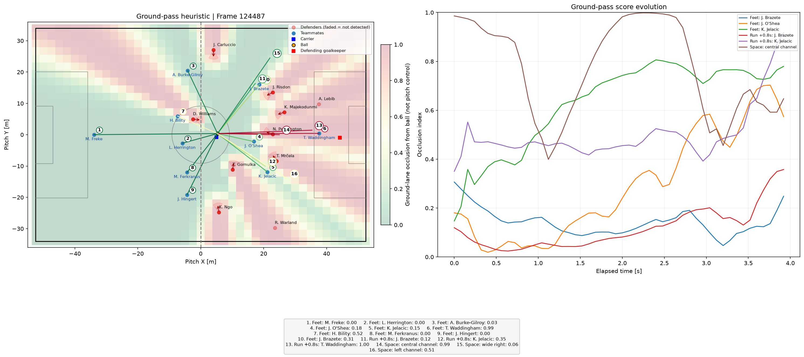

# DLOI-Pose: pose-informed ground passing lane occlusion

Analytics Cup 2.0 | Football Track: Defensive Positioning

DLOI-Pose is an exploratory **heuristic index**, bounded between 0 (open) and
1 (occluded), using player XY positions, optional velocities, and optional
shoulder/head-direction proxies from SkillCorner body pose. It is **not a
calibrated interception probability**, a causal measure of defensive value, or
a validated physical model. There is no native databallpy/kloppy adapter.

## Scientific scope and withdrawn results

**Aerial scoring is unsupported.** SkillCorner pose z is relative to each
player's centroid, not height above the pitch. The previous implementation
compared nose z to a guessed absolute ball parabola, producing unsupported
clearance claims. `is_aerial=True` and an explicit `max_aerial_reach_m` now raise
`NotImplementedError`, including on an empty pitch. No absolute elevation is
inferred from ankles, noses, or the centroid.

Former aerial, causal scanning and season-ranking claims are withdrawn pending
validation. Neck-to-nose direction is **not eye gaze** or scanning range.
`assets/figure1_dloi_pose.png` is historical, not evidence for the current model.

## Implemented algorithm

`src/features/lane_occlusion.py` is the source of truth:

1. Sample 60 equally spaced points by default along the pass, from 5% to 100%
   of its length. This omits the immediate ball-origin region.
2. Estimate arrival time as distance divided by an effective speed, plus up to
   0.35 seconds of receiver control time over the final quarter. Effective speed
   is `max(min(9, v_ball), v_ball - 0.12 * distance)`. This is an arrival-time
   heuristic, not integrated turf-friction dynamics.
3. Drift each defender by supplied velocity for at most 0.35 seconds. Without
   valid pose, reaction time is 0.28 seconds, acceleration coefficient is 4.2,
   and lunge reach is the configured baseline.
4. Validate shoulder XY coordinates, error bounds (0 through 15 cm), and width
   (0.15 through 0.60 m). Rotate the left-to-right shoulder axis 90 degrees for a
   facing proxy. Validate neck/nose XY and errors for a head-direction proxy.
   Blend these with the configured torso weight and **normalize**; if the
   vectors cancel, retain torso direction. Unusable optional pose falls back
   to whichever proxy remains, or to the isotropic baseline.
5. Let alignment be `(1 + cosine_to_sample) / 2`. Pose changes reaction time to
   `0.58 - 0.42 * alignment`, acceleration coefficient to
   `1.8 + 3.2 * alignment`, and lunge reach to
   `base_lunge_reach * (0.75 + alignment) / 1.45`. The default preserves the
   original ground-pass lunge values while honoring nondefault settings.
6. Active time is clipped to [0, 0.95] seconds. Reach is
   `lunge + 0.5 * acceleration_coefficient * active_time**1.8`.
   The fractional exponent and coefficients are empirical, not dimensionally
   established acceleration physics. Combine stationary body and drifted reach
   kernels using their maximum, then take the maximum across defenders.
7. Let `B` be maximum point hazard and `E` the trapezoidal hazard integral over
   the sampled pass fractions, multiplied by `1 + 0.02 * pass_length`.
   Return `clip(1 - (1 - B) * exp(-0.60 * E), 0, 1)`.

Leave-one-out attribution subtracts the score without each defender from the
full score, across supplied lanes. These marginal values are **not additive**;
redundant defenders can both have zero contribution. They depend on the chosen
targets and must not be interpreted as causal or complete defensive value.

## Quickstart

Python 3.9 or newer is required.

```bash
git clone --branch lpobis-cen58041-dloi-pose-audit-and-fixes https://github.com/lukaspobisml/analytics_cup_2.0.git
cd analytics_cup_2.0
python -m pip install -e ".[notebook]"
python -m unittest discover -s tests -v
jupyter notebook notebooks/defensive_lane_occlusion.ipynb
```

The notebook compares **16 ground options**: ten teammates to feet, three
0.8-second constant-velocity run scenarios, and three analyst-selected spaces.
Feet/run targets update each frame. All 22 sample players are shown; a background
map scores passes from the ball to grid points, **not pitch control**.
All lanes have baseline/pose comparisons and temporal summaries; six are plotted
over time. Run scenarios do not infer intent, offside or receiver arrival.
The defending goalkeeper is contextual only, excluded from scoring.
The compressed sample runs without downloads; notebook outputs remain cleared.



```python
import numpy as np
from src.features import DefensiveLaneOcclusion

model = DefensiveLaneOcclusion()
score = model.compute_frame_occlusion(
    [0, 0], [20, 0], np.array([[10, 2]], dtype=float), use_pose=False
)
```

Positions/velocities must be finite, with shapes `(2,)` and `(N, 2)`.
Use `np.empty((0, 2))` for no defenders. Metadata, when supplied, must contain
one dictionary per defender; missing joint observations are permitted.
Invalid required inputs raise `ValueError`; empty candidate lane dictionaries
are rejected. A zero-length ground pass or no defenders returns zero.

## Data, installation and reproducibility

- `src/data/pose_loading.py` streams the packaged compressed sample. Full-match
  downloads are explicit (~600 MB each); cached and new downloads are checked
  against manifest size and SHA256 before reuse/publication.
- Upstream uses mutable `main`; checksums detect changes without pinning a
  revision. No full matches were downloaded.
- Pose is 25 fps, tracking is 10 fps. Frame conversions are explicit. Velocity
  estimation uses actual frame gaps within the same period. Its centered
  differences use future observations and are for retrospective analysis.
- `identify_active_players` is a sample-only movement filter, **not** lineup or
  substitution inference. `build_team_lookup` is seeded with match 1925299's
  roster and is not a general historical roster resolver.
- `extract_frame_entities` returns other detected players, not a team-filtered
  outfield defense. The caller must select opponents and roles.
- Wheels include the manifest and compressed sample, with explicit `src.*`
  package discovery. CI imports the installed package outside the checkout.
- `src.data.basic_loading.load_match` returns event/phase tables and lazy tracking.
- Build docs with `python -m pip install -e ".[docs]"` then `python -m mkdocs build --strict`.

## Remaining limitations and audit follow-up

Ground kernels and pose blending need sensitivity analysis and held-out
calibration. This single-period sample cannot establish full-match behavior or
causality. Off-camera coverage, detection errors and pose/XY misalignment remain
sources of bias.

Phase aggregation now isolates match/period transitions and per-match counts;
it requires two consistent team identities per match and rejects ambiguous
subsets. Dynamic-event `metric_sum_pass_opportunities` still sums **option-row**
values even where intervals overlap, while opportunity counts merge intervals.
An opportunity-level value definition (e.g. maximum versus first value) is
unresolved and was deliberately not guessed.

Height-aware scoring needs validated pitch-relative reach/trajectory inputs.
Historical results need reproducible denominators, coverage, uncertainty and
provenance before republication.
